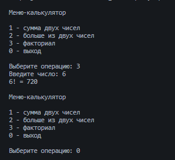
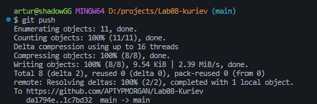

# Практическая работа №8

**ФИО: Куриев Артур Майрбекович**
**Группа: ИСП-241**
**Дата: 13.10.2026**

## Что изучено
1. Полезное использование методов
2. Правильное использование return и break
3. Передача параметров в метод
4. Метод void, который ничего не возвращает

